# Tilty

Tilty puts three big buttons in the title bar of whatever window you're using: **Fill**, **Left Half** and **Right Half**. One click and the window moves. No hovering, no waiting, no menus.

<p align="center">
  
</p>

## Why I built this

If I had a keyboard and a mouse, I would not have built this.

I use a laptop only, and I use the trackpad only. My fingers are big and the macOS window buttons are small. Keyboard shortcuts are hard to remember. To make a window bigger without going full screen, I had to hover over the green button, wait for the menu to show up, and then pick Fill. If I clicked the green button by mistake, the window went full screen and I had to back out of it.

I don't want to wait even a second. It should be click and done. That's it.

Tilty is a personal tool built for exactly that.

## What it does

- Shows a small toolbar right after the traffic lights of the active window.
- **Fill** makes the window as big as the screen without going full screen. The menu bar and Dock stay visible.
- **Left Half** and **Right Half** snap the window to that side of the screen.
- Click the same button again to put the window back where it was.
- The toolbar follows you as you switch apps and windows. It hides while you drag a window and comes back when you let go.
- It stays out of the way for full screen windows, dialogs, sheets and minimized windows.
- Works with multiple displays. The window stays on the screen it's already on.

### Chrome and other Chromium browsers

Chrome puts its tabs right after the traffic lights, so there the toolbar sits at the right end of the tab strip instead. You can change this for any app from the menu bar: **Icons in <App>** then **After the Traffic Lights** or **At the Right End**.

### Menu bar

The Tilty icon in the menu bar has:

- **Pause Tilty** to hide the toolbar for a while.
- **Icons in <App>** to pick where the toolbar sits for the current app.
- **Launch at Login**.
- **Quit Tilty**.

If the icon shows a warning triangle, Tilty is still waiting for Accessibility access.

## Install

Requires macOS 13 or later and Xcode (or the Swift toolchain).

```bash
scripts/build-app.sh --install
```

This builds `Tilty.app`, copies it to `/Applications` and opens it.

Then give it Accessibility access, which it needs to move other apps' windows:

1. macOS shows a prompt. Click **Open System Settings**.
2. In **Privacy & Security > Accessibility**, turn on **Tilty**.
3. Tilty starts on its own within a second. No restart needed.

If the toolbar doesn't show up a few seconds after you turn Tilty on, quit it from the menu bar and open it again.

To build without installing, run `scripts/build-app.sh`. The app lands in `build/Tilty.app`.

### After a rebuild

The app is signed locally (ad hoc), so macOS treats each new build as a new app. After you rebuild, the old Accessibility switch can look on but stop working. `--install` clears the old grant for you, so you just turn Tilty on again when asked. If you built without `--install`, remove Tilty from the Accessibility list with the minus button and add it again, or run:

```bash
tccutil reset Accessibility app.tilty.Tilty
```

## Development

```bash
swift build      # debug build
swift test       # unit tests for the geometry and restore logic
```

If `xcode-select -p` points at Command Line Tools, prefix commands with `DEVELOPER_DIR=/Applications/Xcode.app/Contents/Developer`. The build script does this for you.

Layout:

- `Sources/TiltyCore` holds the pure logic. It covers coordinate flipping, tile frames, screen choice, toolbar placement and the restore memory. It has no AppKit or Accessibility code, so it's easy to test.
- `Sources/Tilty` is the app. It has the menu bar item, the floating toolbar panel, window tracking through `AXObserver` and the window mover.
- `Tests/TiltyCoreTests` has tests for the core.

To change the README animation, edit `scripts/make-demo-svg.py` and run `python3 scripts/make-demo-svg.py`. It writes `docs/demo.svg`.

`Tilty --preview` (run the binary inside the app) draws the toolbar on the frontmost window without needing Accessibility access. It's handy for checking the look.

## Not in scope

- Drag to the screen edge to snap. macOS already does this (System Settings > Desktop & Dock > "Drag windows to screen edges to tile").
- Keyboard shortcuts. The whole point is one click on the trackpad.
